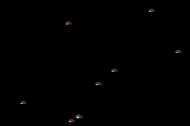

# GBA Bouncer Simulation 🎮

A custom Game Boy Advance homebrew project built in C++ using the **Butano** engine. 

## ✨ Features
* **Dynamic Bouncers:** Spawns multiple objects that bounce off the screen boundaries with randomized 2D velocities.
* **Interactive Player:** Control a custom sprite using the D-pad.
* **Real-time Logging:** Press the **B** button to log the average X position of all active bouncers to the console.
* **Custom Background & Sprite:** Features a retro custom background and unique player sprite asset.

## 🕹️ Controls
* **A Button:** Spawn a new bouncer.
* **B Button:** Log average X position.
* **D-Pad:** Move your custom sprite around the screen.

## 📺 Gameplay Preview

## 🌐 Play Online / Download
You can download the `.gba` ROM from the [Releases page](https://github.com/Arsh2deep/bouncers) or play it live via web emulator on [GitHub Pages] (https://arsh2deep.github.io/bouncers/)